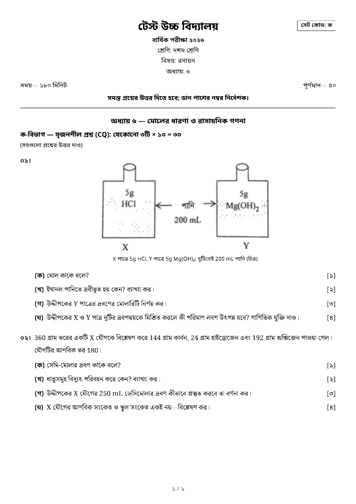
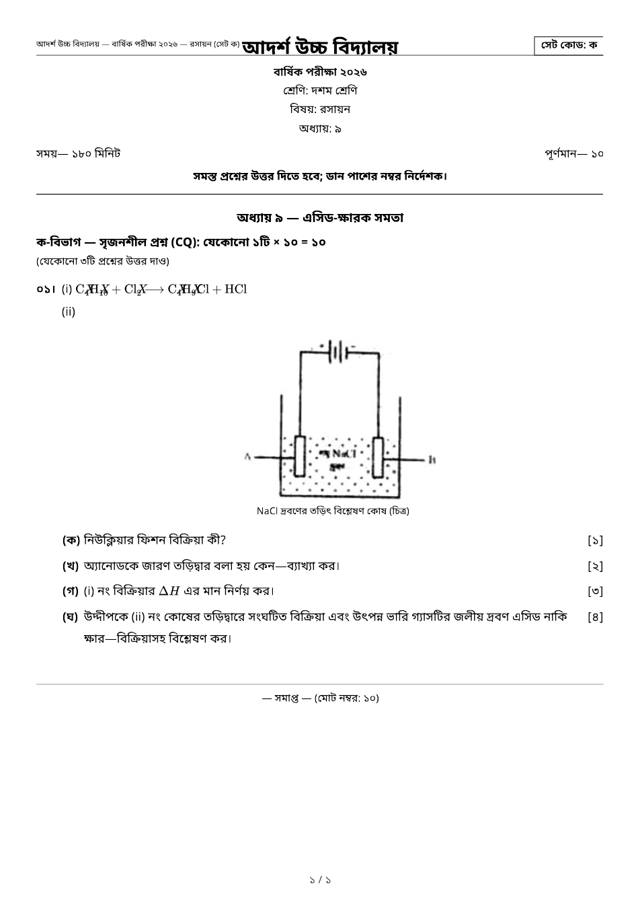

# প্রশ্নব্যাংক — রসায়ন (Bangla Question Bank & Paper Generator)

A teacher-only question bank for Chemistry (রসায়ন), chapters ৬–১০, that builds
printable A4 question papers (CQ + SQ) with correct Bangla typography,
KaTeX/mhchem chemistry, images, Bangla numbering and marks.

**Stack:** Next.js 15 (App Router) · TypeScript (strict) · Tailwind CSS ·
Supabase (Postgres + Auth + Storage) · zod · KaTeX + mhchem · Playwright (PDF).




---

## 1. Quick start (no Supabase needed)

The app ships with a **local/demo mode**: questions are read from `./data`,
saved papers and edits live in `./local-data`. No login is required.

```bash
npm install
echo "DATA_SOURCE=local" > .env.local   # demo mode is explicit, never implicit
npm run dev          # http://localhost:3000 → redirects to /admin
```

That is enough to browse the 149 shipped questions (47 in chapter ৬), build a
paper, print it and download a PDF.

> Demo mode needs an explicit `DATA_SOURCE=local`; a production server also
> needs `ALLOW_LOCAL_DEMO=1` (see [`.env.example`](.env.example)). Without it
> the app runs in Supabase mode and refuses to start when the Supabase values
> are missing. Never deploy in demo mode: it has no authentication.

---

## 2. Supabase setup (~10 minutes)

1. Create a project at <https://supabase.com>.
2. **SQL editor → New query** → paste the whole of
   [`supabase/migrations/0001_init.sql`](supabase/migrations/0001_init.sql) → Run,
   then [`0002_mcq.sql`](supabase/migrations/0002_mcq.sql).
   (Or with the CLI: `supabase link` then `supabase db push`.)
   This creates the tables, indexes, triggers, RLS policies and the public
   `question-images` storage bucket.
3. **Project Settings → API** → copy the Project URL, `anon` key and
   `service_role` key into `.env.local` (see [`.env.example`](.env.example)).
4. Create `.env.local`:

```env
NEXT_PUBLIC_SUPABASE_URL=https://xxxx.supabase.co
NEXT_PUBLIC_SUPABASE_ANON_KEY=eyJ...
SUPABASE_SERVICE_ROLE_KEY=eyJ...
SETUP_SECRET=some-long-random-string
```

5. **Authentication → Providers → Email**: keep it enabled. For a single
   teacher it is easiest to turn **“Confirm email” off**, so the account works
   immediately after creation. (If you keep it on, confirm the email first.)
6. Restart `npm run dev`. The demo banner disappears and `/admin` now asks for
   a login.

### First admin

1. Open `/setup`.
2. Enter an email, a password (8+ chars) and the `SETUP_SECRET` value.
   This creates the auth user **and** inserts it into `public.admins`, which is
   what every RLS policy checks.
3. Log in at `/login`. Every `/admin` route is protected by middleware; without
   a session you are redirected to the login page. Users who are signed in but
   not in `admins` can read nothing (RLS) and are refused by every server
   action.

---

## 3. Import the question bank

```bash
npm run import -- ./data               # import JSON files + ./data/images
npm run import -- ./data --dry-run     # validate + plan only, writes nothing
npm run import -- ./data --no-images   # skip Storage uploads
```

The importer reads **every `*.json` in the folder** (all files must be arrays
with the documented shape), validates each item with zod, and prints a Bangla
report of inserted / updated / unchanged / skipped-with-reason. It upserts by
`id`, so **re-running is always safe** — the second run reports everything as
unchanged. Adding `chem-07.json` … `chem-10.json` needs no code change.

It also:

- uploads figures to the public `question-images` bucket (file name preserved,
  e.g. `chem-06-cq-001.png`);
- adds an admin-only flag for any malformed `$...$` LaTeX (kept in sync on
  re-import, removed once the text is fixed);
- preserves flags an admin added by hand.

The importer needs `SUPABASE_SERVICE_ROLE_KEY` (writes bypass RLS). Use
`--dry-run` without credentials to check the data itself.

---

## 4. Deploy to Vercel

1. Push the repository to GitHub and import it in Vercel.
2. Add the four environment variables from `.env.local` to the Vercel project
   (Production + Preview).
3. Deploy. `npm run build` already passes locally.
4. Run the SQL migration once against the production database (step 2 above).
5. Import the questions from your machine (the script talks to the same
   Supabase project, no deploy needed):
   `npm run import -- ./data`.
6. Open `https://your-app.vercel.app/setup` and create the first admin.

**PDF on Vercel:** `app/api/pdf` launches headless Chromium. Locally it uses
your installed Chrome/Edge; on Vercel it uses
[`@sparticuz/chromium`](https://github.com/Sparticuz/chromium), which is already
a dependency (no extra configuration). Add `PRINT_TOKEN_SECRET` (any long random
string) if you prefer not to reuse the service-role key for print tokens.

`/print/[id]` is authorised by **either** an admin session **or** a short-lived
signed `?t=` token, and is intentionally left out of the edge middleware (the
renderer has no cookie; `node:crypto` is not available at the edge). Guarding it
in middleware would make every downloaded PDF a picture of the login page.

---

## 5. Features

**Dashboard** (`/admin`)

- counts for questions, saved papers, figures and flagged questions; recent
  papers; quick actions; per-chapter jumps into the bank.

**Question workspace** (`/admin/bank`)

- three panes: filter rail (chapter → SQ/CQ/MCQ sub-counts, board, difficulty,
  has-image, flagged, active-filter chips), a dense virtualized question list,
  and the always-visible “আমার পেপার” panel;
- filtering and search run **in memory** on the full index (no round-trip per
  keystroke); `/` focuses search, Esc collapses the open row;
- rows show id, type tag, chapter, boards (one “N বোর্ড” chip), flags and
  marks; click to expand stem, figure and parts in place; `⋯` for edit/delete;
- the paper panel groups by section, supports drag-reorder, per-section
  “যেকোনো N/M”, live totals that follow that choice, প্রিভিউ and প্রিন্ট/PDF;
  below 1100 px it becomes a bottom sheet;
- create / edit / delete questions with a **live preview next to the raw text
  field**, part editor, answer fields and image upload.

**Paper generator** (`/admin/papers/new`)

- three steps with a stepper: ১ প্রশ্ন বাছাই (the workspace) → ২ পেপার সাজানো
  (settings + live preview) → ৩ প্রিন্ট/PDF; a sticky action bar keeps
  সংরক্ষণ · প্রিন্ট · PDF ডাউনলোড on every step;
- start from the panel, or auto-generate with rules such as
  “অধ্যায় ৬: ২ CQ, ৫ SQ; অধ্যায় ৭: ১ CQ, ৩ SQ”, optional board filter,
  “exclude questions used in previous papers”, and shuffle;
- settings grouped into পেপারের তথ্য / লেআউট / প্রিন্ট অপশন plus a collapsed
  “অ্যাডভান্সড” group (mode & formatting, page breaks, logo, auto-generation;
  see “Paper settings” below);
- **live page preview** (A4/A5/B5/Letter/Legal) rendered by the same component
  as the print/PDF output, with a toggleable margin guide;
- warns (never blocks) when two selected questions have the same question text
  after normalisation (digits, punctuation and LaTeX ignored);
- **প্রিন্ট** — saves the paper and opens the real print view
  (`/print/[id]?print=1`), which waits for fonts/figures and then opens the
  browser's print dialog; the same page is rendered server-side for the
  **PDF** download; save, duplicate, edit, delete.

### Paper settings

**পেপারের তথ্য** — paper name, institute, exam name, class, subject, chapter
line (auto-filled from the selected questions, editable), date, time,
duration, instructions, per-section instructions and per-section answer counts
(“CQ-তে উত্তর দেবে কতটি”), set code (ক / খ) with **শাফল** for set খ.

**লেআউট** — page size (A4 default, A5, B5, Letter, Legal), margins (presets
সংকীর্ণ ৮ mm / স্বাভাবিক ১২ mm / প্রশস্ত ১৮ mm, or custom top/right/bottom/left
in mm), 1 or 2 columns (2 is the default for SQ-only papers, otherwise 1),
optional vertical column rule, font size (small / normal / large), spacing
(compact / normal), figure size (ছোট / মাঝারি / বড় = max-height 40 / 55 /
75 mm), SQ marks, page numbers (১ / ৩), “প্রশ্ন একসাথে রাখো” (on: a CQ never
splits; off: it may split between parts, never between a part and its marks),
compact header (class · subject · chapters on one line) and “restart numbering
in every section” (off by default).

**প্রিন্ট অপশন** — “প্রশ্নের উৎস দেখাও” (board/year tag after each question) and
the institution-name watermark. পূর্ণমান is always computed, never typed.

**অ্যাডভান্সড** (collapsed) — mode (পরীক্ষা / সাজেশন শীট) and formatting
(grouping, section order, sort order, chapter page break), the
**সাজেশন শীট অপশন** (only in সাজেশন mode: সময় / পূর্ণমান / নির্দেশনা /
“যেকোনো N টি” / মোট নম্বর toggles), manual page breaks, logo upload, the
`showAnswers` feature flag (off; all answers are `null` anyway) and the
auto-generation rules.

**Auth:** Supabase email + password, middleware-protected `/admin`, first-run
admin setup guarded by `SETUP_SECRET`.

### UI & design tokens

- **Tokens** live in `app/globals.css` (CSS variables) and `tailwind.config.ts`
  (`canvas/surface/line/ink/muted/primary/danger`, 8 px controls, 12 px
  surfaces, 150 ms transitions, focus ring 2 px at 40 %). Screens use 1 px
  borders; shadows are reserved for popovers/dialogs. `prefers-reduced-motion`
  is honoured.
- **Subjects** come from `lib/subjects.ts` (label, dot colour, chapter names,
  `hasData`). The switcher, rail, palette and builder read it; adding a subject
  is a registry entry, not a UI change.
- **Fonts**: Noto Sans Bengali is loaded through `next/font` and emitted into
  the build output, so nothing is fetched from a CDN at runtime (the PDF
  renderer aborts all non-app requests). Bangla text uses 1.7–1.85 line-height.
- **New dependencies**: `lucide-react` (icons), `@tanstack/react-virtual`
  (question list) and `cmdk` (⌘K / Ctrl+K palette). Everything else is
  unchanged.
- **Completeness**: [docs/ui-inventory.md](docs/ui-inventory.md) maps every old
  route/control to its new home.
- **Screenshots** (1440×900, from `e2e/ui-screens.spec.ts`):
  [workspace](screenshots/workspace.png),
  [expanded CQ with figure](screenshots/workspace-expanded-cq.png),
  [paper panel](screenshots/paper-panel.png),
  [builder](screenshots/builder.png),
  [print preview](screenshots/print-preview.png).

### Print & PDF pipeline

- **One print page.** `/print/[id]` is the only thing that prints. The builder’s
  browser-print button opens it with `?print=1` (the dialog opens once the
  sheet reports ready) and `/api/pdf` renders the same URL headlessly, so page
  size, margins, columns, header and page numbers cannot drift between paths.
- **One `@page` rule.** `paperPageCss()` (`lib/paper/sizes.ts`) is injected by
  the paper document: paper size, all four margins and the Bangla page-number
  margin box come from the saved settings for the preview, `window.print()` and
  the server PDF alike.
- **Readiness, not sleeps.** The document sets `data-paper-ready` after the
  fonts are loaded, every figure is decoded and oversized formulas are fitted;
  the renderer waits for that flag. All non-app network requests are aborted, so
  a CDN hiccup cannot change the output.
- **Cache.** The PDF is cached under a sha256 of the paper, its settings and the
  content of every question used; editing anything produces a new hash. A
  repeated download is a map lookup (~50 ms).
- **Timings.** Every render logs
  `[pdf] paper=… launch=…ms navigate=…ms ready=…ms pdf=…ms total=…ms pages=…`
  (also returned in the `X-Pdf-Timings` header, with `X-Pdf-Cache: hit|miss`).
  Measured on the 19-page 1-column chapter ৬–৭ paper (production build, Chrome
  155): cold 2.75 s (launch 0.26 s, navigate 0.72 s, ready 0.39 s, PDF 0.97 s),
  warm render 2.0 s, cache hit 48 ms. The previous per-request-launch path took
  ~13.6 s.

---

## 6. Data model

`questions` (id text pk, subject, chapter, type CQ|SQ|MCQ, stars, boards text[],
question, stem text[], image_path, image_desc, flags jsonb, answer, options
jsonb, correct_option, search_text, timestamps) · `question_parts` (question_id,
label, marks, text, answer, position) · `papers` · `paper_questions`
(position, section, selected_parts text[]; empty = all parts).

- RLS: every table is admin-only; storage writes are admin-only, reads are
  public (questions are printed publicly anyway).
- Indexes: `(subject, chapter, type)`, GIN on `boards`, trigram GIN on
  `search_text` (maintained by trigger from question + stem + parts).
- MCQ is schema-ready (`options`, `correct_option`) but nothing else is built
  for it yet.

### Rendering chemistry

`lib/render/rich-text.ts` splits a string into plain text and `$...$` segments
and renders the math with KaTeX + mhchem (`\ce{...}` works). Plain Unicode
chemistry (`H₂O`, `Mg(OH)₂`, `10⁻³`) is left untouched. A malformed `$...$`
expression is shown as raw text (marked for admins) instead of crashing, and the
importer/admin editor flags it. Stored text is never modified.

---

## 7. Commands

```bash
npm run dev        # dev server
npm run build      # production build (type-checks + lints)
npm start          # serve the build
npm run typecheck  # tsc --noEmit (strict)
npm run lint       # next lint
npm test           # vitest: import validation, marks, auto-generation,
                   # Bangla digits, KaTeX/mhchem rendering, SQL migration + RLS
npm run e2e        # Playwright: question flow + print layout (1/2 columns,
                   # no overflow on any page, server-PDF parity, suggestion
                   # mode, page setup, formula fitting); uses local mode
npm run import -- ./data
```

The Playwright suite uses the machine's installed **Google Chrome**
(`channel: "chrome"`); no browser download is needed. PDF generation in the app
also prefers an installed Chrome/Edge locally.

The e2e run produces `screenshots/paper-page1.png` (PDF page rendered back to an
image) and `screenshots/mhchem-paper.pdf`, which is how Bangla shaping and the
mhchem reaction are visually verified.

---

## 8. Assumptions & defaults

Where the brief left room, these choices were made:

1. **Data folder** — the source files were delivered in `Chemistry/data`; they
   are copied verbatim into `./data` (the path the brief asks for), which is the
   folder the importer reads. Do not hand-edit `./data/*.json`: edit the
   originals and copy again, so the two never drift. `image_path` stores the
   file name exactly as written in the JSON rather than forcing `{id}.png`
   (one figure is a `.jpg`).
2. **Missing figures** — if the referenced image does not exist, the paper shows
   a dashed placeholder with the `image_desc` caption (never a broken-image
   icon), and the importer reports a warning. Four figures are referenced by
   `chem-09.json` but were not delivered (`chem-09-cq-004/005/006/008.png`), so
   those print as placeholders until you drop the scans into `data/images/`.
   Two delivered scans were named `chem-09-cq-01.png` / `-02.png` while the JSON
   asks for `-001.png` / `-002.png`; they were renamed to match the JSON, which
   is the source of truth, and now link correctly.
3. **SQ marks** — SQ items carry no marks in the source data, so the paper has a
   single “SQ নম্বর” setting (default **2**) used for every SQ. CQ marks are the
   sum of the selected parts.
4. **`selected_parts`** — an empty array means “all parts”. Unknown labels fall
   back to all parts, so stale selections can never produce a zero-mark question.
5. **Board filter semantics** — a board filter matches questions whose `boards`
   array contains that board. Questions with an empty `boards` array are
   excluded while a board filter is active.
6. **Numbering** — compact Bangla numbers (`০১।`, `০২।`, …) run continuously
   across sections (CQ first, then SQ). “Restart numbering in every section” is
   **off** by default; when on, each section starts again at `০১।`. Manual page
   breaks always refer to the continuous number, so they do not move when the
   restart option is toggled. Part marks are right-aligned in a narrow column.
   Page numbers are printed by the document’s own `@page` rule as Bangla
   numerals — `content: counter(page, bengali) " / " counter(pages, bengali)`
   in an `@bottom-center` margin box — so browser print and the server PDF show
   exactly the same `১ / ১৯`. This needs Chromium’s CSS page-margin-box support
   (Chrome/Edge ≥ 131; the app’s renderer always uses an installed Chrome). On
   an older engine the margin box is ignored and the sheet simply prints
   without page numbers; change `bengali` to `decimal` in
   `lib/paper/sizes.ts` if a Western `1 / 19` is preferred. In the browser’s
   print dialog leave “Headers and footers” off — otherwise Chrome adds its own
   Western page number (plus URL/date) on top of the Bangla one. The print
   toolbar shows this hint next to the paper size.
7. **Header** — page 1 carries the full header (institution, exam, class,
   subject, chapter, time/পূর্ণমান line, bold instruction line, rule) with the
   set-code box at the top right; the lines stay centred on the page because the
   box is absolutely positioned. Later pages get a one-line running header. The
   full header sits in the table body and covers the repeating header row on
   page 1, while the compact line is repeated by Chromium on every later page
   (verified in the PDF). The live preview is a single continuous A4 sheet;
   actual page breaks are decided by the print engine.
8. **Answers** — every answer in the source data is `null`. Answer printing is
   behind one flag (`settings.showAnswers`, **off** by default, exposed under
   “অ্যাডভান্সড”). Flags are never printed, and the source toggle prints boards
   only — never flags or answers.
9. **Admin model** — a single `admins` table; any signed-in admin can manage
   everything (no per-teacher ownership restrictions on papers).
10. **Demo mode** — explicit `DATA_SOURCE=local` (plus `ALLOW_LOCAL_DEMO=1` on
    a production `next start`) reads `./data`, persists edits/papers in
    `./local-data`, and skips auth. Intended for evaluation/development only.
11. **Images in local mode** are served by `/api/images/[name]` from
    `./local-data/images` (uploads) falling back to `./data/images`. In Supabase
    mode the same route proxies the public `question-images` bucket, so print/PDF
    stay same-origin.
12. **Logo** is uploaded through the same `/api/upload` endpoint and stored as
    `settings.logoUrl`.
13. **Sets** — “সেট ক / সেট খ” stores two explicit question-id orderings in
    `settings.sets`; only the active set code (`settings.setCode`) is printed,
    and its code appears in the header box. **শাফল** keeps set ক as it is and
    stores a shuffled order as set খ, switching the paper to খ.
14. **Total marks** — পূর্ণমান (header, preview, tray summary and footer) is the
    sum of the sections as answered: `যেকোনো N × marks` when every question in
    the section has the same marks. If they differ, the plain sum is kept and a
    small note (“প্রশ্নগুলোর নম্বর ভিন্ন — যোগফল দেখানো হয়েছে”) is printed, so
    no total is ever silently wrong. The server recomputes it on save.
15. **Columns** — the setting applies to the whole body and is a real
    newspaper flow (`column-count`), so the left column fills before the right
    one and both continue on the next page. Nothing can widen a column:
    `min-width: 0` on every item, the CQ parts table uses `table-layout: fixed`
    (an unbreakable formula can no longer stretch it), board tags wrap, figures
    are capped by the figure-size setting, and a formula wider than its column
    is measured after the fonts load and scaled down to fit. Two-column bodies
    use a CSS column rule as the optional divider.
16. **Watermark** — the institution name, rotated and printed at 6% opacity
    behind the text (fixed positioning repeats it on every printed page); it
    cannot hide question text because it sits underneath the content.

---

## 9. Acceptance criteria — how they are met

1. `npm run import -- ./data --dry-run` validates **47 items in chem-06.json
   (28 SQ + 19 CQ)** (149 items across chapters 6–10) and the planner marks a
   second run as fully unchanged. CQ images are uploaded by the real run.
2. The e2e test filters chapter ৬ in the workspace, selects **3 CQ + 5 SQ**,
   opens the preview step, checks the A4 preview (Bangla numbering/marks),
   saves it, verifies the print view and downloads a real PDF. A second spec
   captures the five redesign screenshots at 1440×900 in `screenshots/`
   (`workspace.png`, `workspace-expanded-cq.png`, `paper-panel.png`,
   `builder.png`, `print-preview.png`).
3. Flags and answers are absent from the print view and PDF (asserted in the
   e2e test and by construction: only the document model is printed).
4. Adding `chem-07.json` … `chem-10.json` required no code changes — all five
   files are imported by the same loop.
5. This README's Supabase + Vercel walkthrough is the deploy path (schema,
   env vars, import, first admin).
6. `chem-09-cq-001` renders `C₄H₁₀ + Cl₂ ⟶ C₄H₉Cl + HCl` via mhchem above the
   figure — visible in the preview, the print view and the PDF
   ([screenshot](screenshots/mhchem-paper-page1.png)).
7. `e2e/print-layout.spec.ts` builds the real chapter ৬–৭ paper (all SQ + CQ,
   92 questions) in 1 and 2 columns and asserts: no text leaves the printable
   area on any page (custom and preset margins), both columns are used, and the
   server PDF has exactly the same page count and Bangla page numbers as
   browser print.
8. Page setup, suggestion mode, figure sizes, split/keep-together and the
   compact header are covered by the same spec; the unit tests cover margin
   presets, the `@page` rule and the suggestion-mode model.
9. PDF speed: cold 2.75 s, warm 2.0 s, cached 48 ms for the 19-page paper (see
   “Print & PDF pipeline”); no fixed sleeps and no external requests in the
   renderer.

---

## 10. Project layout

```
app/                 routes: /, /login, /setup, /admin/*, /print/[id], /api/*
components/          UI: bank, builder, paper document, tray, toasts
lib/                 schemas (zod), rendering, marks, autogen, data stores, PDF
supabase/migrations/ 0001_init.sql (tables, RLS, triggers, storage)
scripts/import.ts    idempotent importer
data/                source JSON + images
e2e/                 Playwright flow + PDF→PNG verification helper
```
